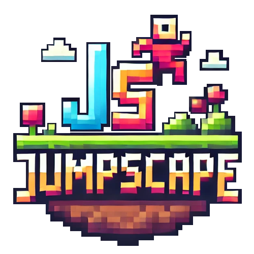

# JumpScape



JumpScape is a 2D platformer built with [MonoGame](https://monogame.net/) and C#. Climb from the ground up
through floating platforms to reach the exit door. Watch out for frogs and ghosts (or knock them out with a
glowing orb), spikes, and platforms that crumble under your feet. Some doors are locked, so find the key
first, and look out for hidden gems on the way.

## Features

- Twelve levels that start easy and get harder (see [Levels](#levels) below), plus a JSON level format for
  making your own, with autocomplete and error checking in VS Code ([Levels/README.md](Levels/README.md)).
  An automated player has finished every level and collected every gem, so each one is known to be
  possible ([Running the checks](#running-the-checks)).
- A level editor in the game: draw platforms and spikes with the mouse, place doors, portals, keys, gems,
  ghosts, springs and more, and try the level out straight away ([Level editor](#level-editor)).
- Jumps that feel fair: tap jump for a little hop or hold it for a full jump, and a jump still works just
  after you walk off an edge or just before you land.
- Levels can have several areas joined by glowing portal doors, like a dark red nether or a night sky.
- Frogs that patrol platforms, ghosts that chase you, spikes, crumbling platforms, and locked doors with keys.
- Moving platforms that carry you across gaps or up like a lift, and bounce pads that launch you high.
- Checkpoint flags in the longer levels: after touching one, you can come back to it when you die.
- Hidden gems in every level, and gold, silver and bronze medals for finishing quickly.
- Throw glowing orbs at enemies by clicking where you want them to go.
- Play with the keyboard and mouse or a gamepad. Hints in the game show the buttons of whichever you use.
- Pip, a friendly explorer, explains the controls in Level 1 and gives tips in later levels.
- Race your best run: after you finish a level, a see-through ghost replays your fastest run while a
  timer shows your time and your best. Best times also appear in the level picker.
- Power-ups: hearts that heal you, plus double jump and high jump orbs that last 15 seconds.
- Three hearts of health, knockback, and a short moment of invincibility after every hit.
- Sounds that get quieter with distance and come from the left or right.
- Starts in fullscreen. Settings (mouse or keyboard) for:
  - Gameplay: race your best run, show the timer, **extra hearts** (five instead of three, for an easier
    game) and **unlock all levels**.
  - Graphics: a 30 or 60 FPS limit, fullscreen and VSync.
  - Audio: game volume, music volume and mute.
  - **Controls**, where you can choose your own keys, and **Reset** to start over (it asks first).
- Your progress and settings are saved. **Play** continues with the next level you haven't finished.
- A level picker with the name, best time, medal, gems and a short description of each level, and the total
  of all your best times. Finished levels get a star, the next one to play glows, and later levels stay
  locked until you finish the one before.
- Wooden menus throughout: pause (resume, restart the level, change your keys), game over, and a level
  complete screen with your time, medal, gems and a **Next level** button.
- A soft, blurred forest behind each level that scrolls slowly as you climb, plus dust puffs, a little
  bounce when walking, and hints like **[E] Open** next to doors.
- Levels are designed for 1920×1080 and scaled to fit any window. A window of a different shape shows a bit
  more of the world instead of black bars.

## Requirements

- The [.NET SDK](https://dotnet.microsoft.com/download), version 8.0 or newer.
- Windows, macOS or Linux.
- The **Arial** font, which the build uses to create the game's font. Windows and macOS already have it.
  On Linux, install Microsoft's core fonts first (for example `sudo apt install ttf-mscorefonts-installer`).

You don't need to install MonoGame separately. It comes from NuGet, and its content tools are restored
automatically the first time you build.

## How to run

From the repository folder:

```bash
dotnet run
```

The first run takes a minute or two because it downloads packages and builds the images and sounds.
Later runs start almost immediately.

You can also open the folder in **VS Code** and press F5, or open `JumpScape.sln` in **Visual Studio** or
**Rider** and press Run.

### Making a copy to share

To build a version that runs on a computer without .NET installed:

```bash
dotnet publish JumpScape.csproj -c Release -r win-x64 --self-contained -o publish
```

Zip the `publish` folder and share it; players start `JumpScape.exe`. For other systems, replace `win-x64`
with `osx-arm64` (Apple Silicon Mac), `osx-x64` (Intel Mac) or `linux-x64`.

## Controls

| Action                 | Keys                                    |
| ---------------------- | --------------------------------------- |
| Move                   | Arrow keys or A / D                     |
| Jump                   | Space, W or Up arrow (hold for a higher jump) |
| Use the door, talk     | E                                       |
| Select inventory slot  | 1, 2, 3                                 |
| Drop the selected key  | Q                                       |
| Throw an orb           | Left mouse button (aim with the mouse)  |
| Pause / back           | Esc                                     |
| Menus                  | Arrow keys or W / S, Enter or Space, or the mouse |

With a gamepad:

| Action                 | Gamepad                                 |
| ---------------------- | --------------------------------------- |
| Move                   | Left stick or D-pad                     |
| Jump                   | A (hold for a higher jump)              |
| Use the door, talk     | X                                       |
| Select inventory slot  | LB / RB                                 |
| Drop the selected key  | Y                                       |
| Throw an orb           | RT (aim with the right stick, or it flies straight ahead) |
| Pause                  | Start                                   |
| Menus                  | Left stick or D-pad, A to choose, B to go back |

You can choose your own keys for moving, jumping, using doors and dropping keys under
**Settings → Controls** (also in the pause menu): click a box and press the key you want. The hints in the
game and what Pip says follow your keys.

## Levels

| Level | Name            | What's new                                                                   |
| ----- | --------------- | ---------------------------------------------------------------------------- |
| 1     | First Steps     | Easy stairs. Pip explains the controls, and there's one frog to practise on. |
| 2     | Frog Pond       | Frogs on most platforms.                                                     |
| 3     | Crumbling Path  | Platforms that break under your feet.                                        |
| 4     | The Key         | A locked exit. Climb up and back to fetch the key.                           |
| 5     | Spring Meadow   | Bounce pads: the only way up is to let them launch you. Pip explains them.   |
| 6     | Ghost Garden    | Ghosts that chase you, and a double jump.                                    |
| 7     | Leap of Faith   | Long jumps between narrow platforms, spikes and the first checkpoint.        |
| 8     | Into the Nether | A portal to the nether, where the key is.                                    |
| 9     | Twin Keys       | Two keys, a locked portal and a night sky.                                   |
| 10    | Sky Ferry       | Moving platforms: two ferries and a lift.                                    |
| 11    | Sky Tower       | A tall climb with frogs, ghosts and crumbling ledges, and two checkpoints.   |
| 12    | The Gauntlet    | The finale: the nether for the key, then the longest climb.                  |

## How to play

- Reach the door at the end of the level and press **E** to open it, then **E** again to go through. The
  level complete screen shows your time and lets you go to the next level, play again or go back to the menu.
- A locked door needs a key. Pick up the key, select its inventory slot with **1–3**, and press **E** next
  to the door to unlock it. Each locked door uses up one key. Press **Q** to drop the selected key again.
- Glowing doors are portals to another part of the level. Open one with **E** and press **E** again to go
  through. The portal on the other side brings you back.
- Frogs take a whole heart if they walk into you and half a heart if you bump into them from behind.
  Ghosts take half a heart. After a hit you flash orange and can't be hurt for a moment.
- Click to throw an orb towards the mouse. One orb defeats a frog or a ghost. Orbs stop when they hit a
  platform, and you can throw about two per second.
- Power-ups float in the level; touch one to collect it:

  | Power-up         | Looks like  | Effect                                                         |
  | ---------------- | ----------- | -------------------------------------------------------------- |
  | Heart            | A red heart | Gives back one heart. It stays put if your health is full.     |
  | Double jump      | Green orb   | Press jump again in mid-air to jump a second time. Lasts 15 s. |
  | High jump        | Red orb     | Jump about one and a half times as high. Lasts 15 s.           |

  Active power-ups show under your hearts, with a bar for the time left.
- Crumbling platforms start shaking when you land on them, break after three seconds and come back five
  seconds later.
- Spikes take a whole heart and bounce you away.
- Moving platforms glide back and forth along the dotted line under them, and carry you while you stand on
  them. Wait for one to come close, jump on, and jump off at the other end.
- Bounce pads (red springs) launch you about 600 px up when you land or walk on them. Steer while you fly.
  They also give back your double jump.
- Touch a checkpoint flag to make it green. If you die after that, **Back to checkpoint** brings you back
  there with full health, and everything you collected stays collected. A run that used a checkpoint
  doesn't count as a best time.
- Each level hides two or three gems, shown in the top-right corner. Gems count when you finish the level,
  and ones you found before show as see-through.
- Finish fast for a medal. The level picker shows the gold, silver and bronze times for each level.
- Press **E** next to Pip to talk. **E** (or Enter, Space or a click) shows the next line, and **Esc** ends
  the conversation. The game waits while you talk.
- Your time is shown at the top. Finish faster than before to set a new best; the ghost of your best run
  races you next time. You can turn the ghost and the timer off under **Settings → Gameplay**.
- Stuck? **Esc** pauses the game, where you can restart the level or look up the controls. If a level is
  too hard, turn on **Extra hearts** in the settings.

## Level editor

Choose **Level Editor** in the main menu, then a level to change or **+ New level**. A new level starts with
the ground, a start and an exit door.

- Pick a tool in the top bar, or with the keys **1–9** and **0**. **Platform** and **Spikes** draw by
  dragging in the level. The other tools add something with a click, standing on the platform under the
  mouse (gems and ghosts float where you click). **Start** moves where the player starts.
- With **Select**, click something to change it in the bar at the bottom: a frog on a platform, crumbling,
  locked doors, where a portal leads, the type of power-up, what Pip says, and so on. Drag it to move it, or
  drag the right edge of a platform or spikes to make them longer.
- To make a moving platform, select it, tick **Moves**, and drag the blue outline to where it should go.
- The second portal you add leads to the first one, and back.
- **+ Area** adds another area, like the nether. The tabs switch between areas.
- **Level settings** has the level's name and description, the medal times, and the current area's name,
  sky color and platform color.

| Action                          | Keys                                       |
| ------------------------------- | ------------------------------------------ |
| Delete                          | Right-click, or Delete                     |
| Copy the selected thing         | Ctrl+D                                     |
| Nudge the selected thing        | Arrow keys (Shift for 10 px)               |
| Place freely, off the 10 px grid | Hold Shift while dragging or clicking     |
| Scroll up and down              | Mouse wheel, W / S, Page Up / Page Down; Home goes back down |
| Undo / redo                     | Ctrl+Z / Ctrl+Y                            |
| Save                            | Ctrl+S                                     |
| Try the level out               | F5                                         |
| Deselect, then leave            | Esc                                        |

A try-out doesn't count as finishing the level and doesn't save a best time; **Back to editor** in the pause
menu returns to the editor. Saving writes `LevelN.json` next to the game, and also into the project's
`Levels` folder when the game runs from the repository, so the new level can be committed. Saving rewrites
the whole file, so comments in it are not kept. More about the level files is in
[Levels/README.md](Levels/README.md).

## Saved data

Settings (including your keys) and progress (finished levels and found gems) are saved as small files:
`settings.json`, `progress.json`, and one `best-run-levelN.bin` per level with your fastest run:

- Windows: `%APPDATA%\JumpScape\`
- macOS and Linux: `~/.config/JumpScape/`

To start over, use **Settings → Your progress → Reset**, or delete the files.

## Project structure

```text
Program.cs                Entry point
Source/
  JumpScapeGame.cs        Window, music, switching between screens, and drawing
  Core/                   Assets, input, settings, save files and screen scaling
  Gameplay/               The level being played: player, platforms, enemies, doors, items, effects, backdrop
  Menus/                  Main menu, level picker, settings, shared wooden UI pieces, and the panel menus
                          used for pause, game over and level complete
  Editor/                 The level editor, and the writer that saves level files
Content/
  Content.mgcb            List of every image, sound and font the game uses
  Fonts/ Graphics/ Sounds/
Levels/                   Level files (LevelN.json), their schema, and a guide (Levels/README.md)
Tests/                    The automated checks, including the automated player
```

The images, sounds and font are built by the MonoGame content pipeline. If you add a new asset, add it to
`Content/Content.mgcb`, either by hand or with the MGCB Editor (`dotnet mgcb-editor Content/Content.mgcb`).

## Running the checks

The `Tests` project drives the game frame by frame with made-up key presses and mouse clicks, and checks
that everything works. It opens a small window while it runs and never touches your own saved games.

```bash
dotnet run --project Tests
```

runs every check (about 290) and saves screenshots in `Tests/bin/Debug/net8.0/screenshots`.

```bash
dotnet run --project Tests -- --levels
```

lets an automated player play every level: once collecting every gem, and once straight to the exit, which
must beat the level's gold time. Add level numbers to play only some, like `--levels 3,7`.

```bash
dotnet run --project Tests -- --overview
```

saves a picture of every area of every level, tall enough to show the whole climb.

## License

This project is licensed under the MIT License.
